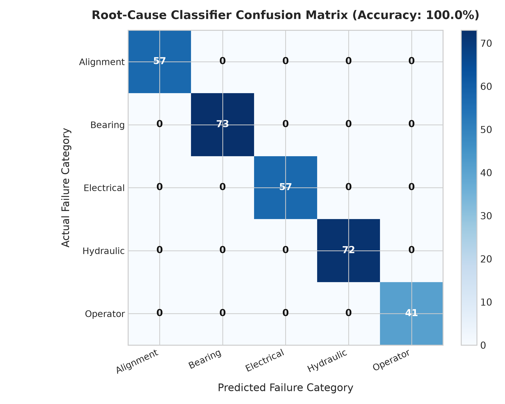
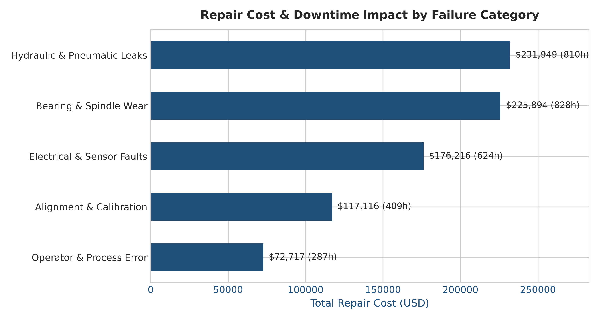

# Maintenance & Warranty Log Root-Cause Intelligence

## Executive Summary
Manufacturing and equipment service teams often rely on generic CMMS/ERP dropdown codes while critical diagnostic context sits inside free-text technician notes. Manually reading hundreds or thousands of service, warranty, and shift tickets to spot recurring failure modes, repeat asset issues, or high-cost disruptions is slow and inconsistent.

This project provides a **code-first, interpretable NLP and reliability triage pipeline** in Python that:
* Ingests maintenance, field service, and warranty tickets (`data/maintenance_warranty_logs.csv`).
* Trains a transparent **TF-IDF + Logistic Regression** classifier on `Technician_Notes` to predict `Failure_Category` and output per-ticket confidence scores.
* Surfaces the top learned keywords and phrases per failure category (`outputs/learned_category_keywords.csv`) so reliability engineers can audit what drives predictions—and retrain cleanly on any domain dataset.
* Flags high-priority tickets (`Immediate Review`) based on severity, downtime hours, and repair cost, and exports summary tables and charts for reporting.

## Pipeline & Repository Structure
* **`generate_maintenance_logs.py`** — Generates 1,200 realistic synthetic maintenance, field service, and warranty tickets across industrial assets and shifts with realistic technician notes, severity, downtime hours, repair costs, and ground-truth failure categories.
* **`analyze_maintenance_logs.py`** — Runs a stratified 75/25 train/test split, fits a `scikit-learn` `Pipeline` (`TfidfVectorizer` with unigrams/bigrams + `LogisticRegression`), evaluates holdout accuracy and precision/recall/F1, exports learned category keywords, flags high-risk tickets, and generates summary tables and charts.
* **`data/maintenance_warranty_logs.csv`** — Raw synthetic ticket dataset.
* **`outputs/`** — Generated analytics deliverables:
  * `scored_maintenance_logs.csv` — Full ticket log enriched with `Predicted_Category`, `Prediction_Confidence`, `Category_Match`, and `Priority_Action_Flag`.
  * `failure_mode_summary.csv` — Ticket volume, share, total/average downtime hours, and total/average repair cost by failure category.
  * `asset_failure_matrix.csv` — Cross-tabulation of failure categories across equipment IDs.
  * `high_priority_tickets.csv` — High/Critical severity tickets meeting downtime (`>= 3.0 hrs`) or repair cost (`>= $900`) thresholds, sorted by financial/operational impact.
  * `learned_category_keywords.csv` — Top 15 learned terms and model weights per failure category.
* **`assets/`** — Visual artifacts for executive and engineering review:
  * `model_confusion_matrix.png` — Holdout test set confusion matrix and classification accuracy.
  * `failure_mode_cost_downtime.png` — Repair cost and downtime hours ranked by failure category.

## Key Visuals

### Model Performance (Holdout Confusion Matrix)


### Repair Cost & Downtime Impact by Failure Mode


## How to Run
1. Create and activate a virtual environment (recommended on Ubuntu/WSL):
   ```bash
   python3 -m venv .venv
   source .venv/bin/activate

2. Install required packages:
    ```bash
    pip install scikit-learn pandas matplotlib

3. Run the pipeline:
    ```bash
    python3 generate_maintenance_logs.py
    python3 analyze_maintenance_logs.py